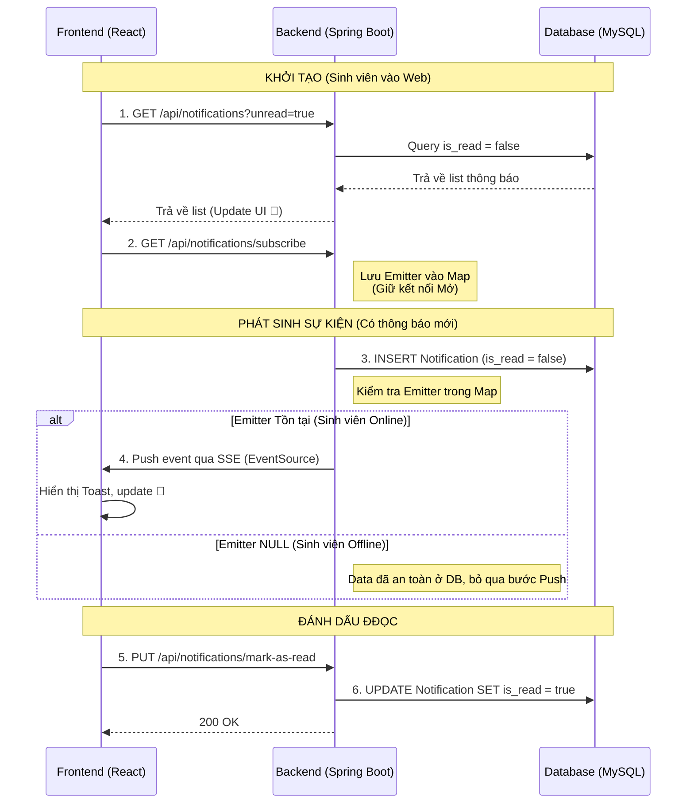

# Quy trình xử lý Thông báo chủ động (Push Notification) bằng SSE

Tài liệu này mô tả chi tiết workflow xử lý thông báo chủ động trong hệ thống GPMS, kết hợp giữa cơ chế "Kéo" (REST API) và "Đẩy" (Server-Sent Events - SSE) để đảm bảo tính thời gian thực và không thất thoát dữ liệu khi người dùng offline.

## 1. Cấu trúc Database yêu cầu
Tất cả các thông báo phát sinh trong hệ thống bắt buộc phải được lưu trữ vào Database trước khi thực hiện bất kỳ hành động nào khác.

**Bảng `Notification` (Ví dụ):**
- `id`: Khóa chính
- `user_id`: ID của người nhận (Ví dụ: ID Sinh viên)
- `content`: Nội dung thông báo
- `type`: Loại thông báo (INFO, WARNING, SUCCESS...)
- `is_read`: Boolean - Trạng thái đã đọc (Mặc định: `false`)
- `created_at`: Thời gian tạo

---

## 2. Các Workflow chi tiết

### Workflow 1: Khởi tạo khi Sinh viên truy cập hệ thống (Đăng nhập / Mở web)
Mục tiêu: Lấy lại các thông báo bị lỡ lúc offline và thiết lập kênh lắng nghe thông báo mới.
1. **Fetch dữ liệu cũ (REST API):** Frontend gọi API `GET /api/notifications?unread=true`.
2. Backend truy vấn DB, trả về danh sách các thông báo của sinh viên đó có `is_read = false`.
3. Frontend hiển thị số lượng chưa đọc lên biểu tượng 🔔.
4. **Mở kết nối (SSE):** Ngay sau khi fetch xong, Frontend tiếp tục gọi API `GET /api/notifications/subscribe`.
5. Backend tạo ra đối tượng `SseEmitter`, lưu vào `ConcurrentHashMap` với key là `student_id`, và giữ kết nối HTTP này mở liên tục chờ sự kiện.

### Workflow 2: Xử lý khi có sự kiện hệ thống phát sinh
Ví dụ: Giáo viên hướng dẫn nhấn "Duyệt đề cương".
1. Backend xử lý logic duyệt đề cương xong.
2. **Lưu DB (Bắt buộc):** Backend tạo một bản ghi `Notification` mới (với `is_read = false`) và lưu vào Database.
3. **Kiểm tra trạng thái Online:** Backend tìm trong `ConcurrentHashMap` xem có `SseEmitter` nào tương ứng với `student_id` này không.
    - **Trường hợp A (Sinh viên đang Online):** Tìm thấy `Emitter`. Backend gọi `emitter.send(noti_data)`. Dữ liệu lập tức chạy qua đường ống SSE về Frontend. Frontend nhận được, hiện popup (Toast) và tăng số đếm trên 🔔.
    - **Trường hợp B (Sinh viên đang Offline):** Không tìm thấy `Emitter` (hoặc bằng null). Backend **không cần làm gì thêm**. Kết thúc quy trình. Dữ liệu đã an toàn.

### Workflow 3: Sinh viên từ trạng thái Offline chuyển sang Online
1. Khi sinh viên offline, các thông báo vẫn được sinh ra ở Workflow 2 và được lưu an toàn trong Database với trạng thái `is_read = false`.
2. Ngày hôm sau, sinh viên mở máy và truy cập vào ứng dụng.
3. Hệ thống sẽ tự động thực hiện lại **Workflow 1**. Nhờ bước "Fetch dữ liệu cũ", sinh viên sẽ ngay lập tức nhìn thấy toàn bộ các thông báo đã bị bỏ lỡ trong thời gian đi ngủ (offline).

### Workflow 4: Đánh dấu đã đọc
1. Sinh viên click vào icon 🔔 để xem chi tiết danh sách thông báo.
2. Frontend gọi API `PUT /api/notifications/mark-as-read` (truyền mảng ID thông báo hoặc gọi cập nhật toàn bộ).
3. Backend update Database, chuyển các bản ghi tương ứng thành `is_read = true`.

---

## 3. Sơ đồ tuần tự (Sequence Diagram)

